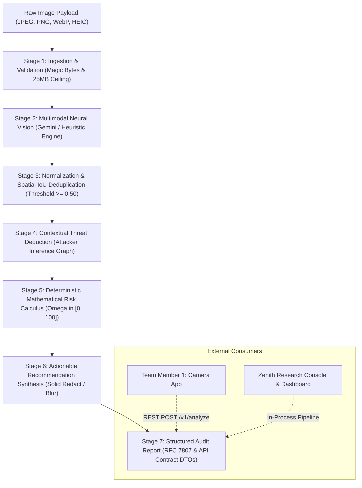

# Zenith 🛡️
## AI-Powered Privacy Intelligence & Risk Assessment System

> **"Identify, explain, and mitigate visual operational security leaks before photographs are shared online."**

Zenith is a defensive privacy intelligence system engineered to inspect visual assets through the perspective of an **adversarial threat investigator** or **open-source intelligence (OSINT) analyst**. It detects direct visual exposures, deduces compound contextual inferences, calculates mathematically bounded risk scores, and generates actionable, prioritized remediation guidance.

---

## 🏛️ System Architecture

Zenith separates the core privacy intelligence analysis pipeline from camera capture interfaces. Captured media from external clients (such as Team Member 1's mobile camera application) is submitted via a stable, versioned API contract.



### Module Layout
```
lib/
├── core/
│   ├── privacy_engine/
│   │   ├── api/zenith_api_contract.dart       # Versioned API contract DTOs & client adapters
│   │   ├── inference/contextual_inference_engine.dart # Attacker-perspective threat inference graph
│   │   ├── pipeline/zenith_analysis_pipeline.dart    # Master deterministic analysis orchestration
│   │   ├── providers/vision_analysis_provider.dart   # Gemini 2.5 Vision & mock test providers
│   │   ├── recommendations/recommendation_engine.dart # Prioritized mitigation checklists
│   │   ├── scoring/deterministic_risk_engine.dart     # Pure mathematical risk formulation
│   │   ├── testing/test_case_framework.dart          # 15-class automated benchmark test runner
│   │   └── validation/image_validator.dart           # Payload validation & magic byte inspection
│   ├── constants/app_constants.dart
│   └── theme/
│       ├── app_colors.dart                           # Cyber OPSEC theme palette
│       └── app_theme.dart
├── models/
│   ├── detected_element.dart                         # Normalized finding with IoU & risk contribution
│   ├── exposure_category.dart                        # 5 Domains: Identity, Location, Digital, Personal, Transport
│   ├── inferred_insight.dart                         # Attacker deductions, evidence links, epistemic status
│   ├── privacy_audit_report.dart                     # Master audit report with JSON serialization
│   ├── recommendation.dart                           # Actionable mitigations with risk reduction estimate
│   ├── risk_level.dart                               # Low (0-25), Moderate (26-50), High (51-75), Critical (76-100)
│   └── user_settings.dart
├── providers/
│   ├── audit_provider.dart                           # Riverpod state management for audit workflow
│   └── settings_provider.dart
├── screens/
│   ├── home_screen.dart                              # Research console, OPSEC radar, benchmark runner
│   ├── analysis_screen.dart                          # Real-time multi-stage scanning HUD
│   ├── results_screen.dart                           # Risk gauge dial, overlay inspector, inference cards
│   ├── camera_screen.dart                            # Onboard camera viewfinder
│   ├── history_screen.dart                           # Audit archive & persistent forensic records
│   ├── settings_screen.dart                          # Model configuration & key management
│   └── widgets/
│       ├── auto_redact_preview_modal.dart            # Interactive redaction & privacy shield sandbox
│       ├── cyber_glass_card.dart
│       ├── detected_element_tile.dart
│       ├── exposure_category_card.dart
│       ├── glowing_scanner_hud.dart
│       ├── image_inspection_overlay.dart             # Normalized bounding box overlays
│       ├── inference_card.dart
│       ├── recommendation_card.dart
│       └── risk_meter_gauge.dart
├── services/
│   ├── gemini_vision_service.dart                    # Gemini multimodal integration adapter
│   ├── mock_analysis_service.dart                    # Heuristic simulation engine
│   ├── sample_data_service.dart                      # Calibrated threat scenarios
│   └── storage_service.dart                          # SharedPreferences audit persistence
└── main.dart
bin/
└── zenith_server.dart                                # Standalone HTTP backend service (Port 8080)
test/
├── deterministic_risk_engine_test.dart               # Mathematical calculus unit tests
├── image_validator_test.dart                         # Magic bytes & corruption unit tests
├── pipeline_test.dart                                # End-to-end pipeline execution tests
├── risk_calculator_test.dart                         # Model classification tests
├── server_test.dart                                  # Live HTTP integration tests (Analyze & Rescan)
├── test_case_framework_test.dart                     # 15 standard threat class benchmark suite
└── widget_test.dart                                  # Dashboard UX widget tests
```

---

## 🧮 Deterministic Risk Scoring Formulation

Zenith reserves numerical scoring authority exclusively for its deterministic calculus engine, ensuring AI models cannot generate arbitrary or uncalibrated risk scores:

### 1. Individual Finding Contribution ($R$)
For each normalized finding $f_k$:
$$R(f_k) = S(f_k) \cdot E(f_k) \cdot V(f_k) \cdot C(f_k)$$
- **$S \in [1, 100]$:** Intrinsic information sensitivity
- **$E \in [0.2, 1.0]$:** Exploitability factor
- **$V \in [0.1, 1.0]$:** Visual prominence and legibility score
- **$C \in [0.0, 1.0]$:** Detector confidence

### 2. Category Probability Bounded Sum ($CS_c$)
Detections within category $c$ aggregate via a bounded probabilistic complement, preventing double-penalties:
$$CS_c = 100 \cdot \left(1 - \prod_{k=1}^{n_c} \left(1 - \frac{R(f_{k, c})}{100}\right)\right)$$

### 3. Unified Overall Score ($\Omega$)
$$\Omega = \min\left(100, \; \max_{c}(CS_c) + \beta \sum_{c \neq \text{peak}} CS_c + \Gamma(I)\right)$$
- **Peak Anchor $\max_c(CS_c)$:** Overall risk is at least as severe as its single worst compromised domain.
- **Secondary Breadth $\beta = 0.12$:** Compound penalty for diffuse multi-domain exposures.
- **Inference Synergy $\Gamma(I) \in [0, 15]$:** Compound threat deduction bonus: $\min\left(15, \sum 5.0 \cdot C(i_j)\right)$.
- **Critical Credential Floor:** Any single credential with $R(f_k) \ge 90$ strictly anchors $\Omega \ge 90$.

### Calibrated Operational Bands
| Score Range | Severity Band | Operational Action |
| :---: | :---: | :--- |
| **0 – 25** | **LOW** | Safe for public online publication; minimal OPSEC exposure. |
| **26 – 50** | **MODERATE** | Peripheral background exposure; crop or soften before posting. |
| **51 – 75** | **HIGH** | Significant tracking or transit vectors; apply targeted blur filters. |
| **76 – 100** | **CRITICAL** | Severe credential or PII breach; solid black redaction bar mandatory. |

---

## 📡 Camera Application Integration (Team Member 1)

Zenith provides a documented, versioned HTTP REST interface (`v1`) and a Dart in-process adapter (`ZenithLocalClient`). External camera clients never interact directly with Gemini API keys.

### Start the Zenith Server
```bash
# Start on default port 8080 (or specify --port <N>)
dart run bin/zenith_server.dart --port 8080
```

### Server Endpoints
- **`GET /health`**: Health check and service metadata.
- **`POST /v1/analyze`**: Submit an optical payload for privacy assessment.
- **`POST /v1/rescan`**: Submit a redacted photograph to verify residual risk reduction.

### Example: Analyze Request (`POST /v1/analyze`)
```json
{
  "image": "<base64_encoded_jpeg_or_png>",
  "clientRequestId": "cam_capture_98412",
  "sensitivityProfile": "balanced",
  "clientVersion": "1.0.0"
}
```

### Example: Analyze Response (`200 OK`)
```json
{
  "analysisId": "audit_1740000000000",
  "timestamp": "2026-10-11T22:50:00.000Z",
  "processingDurationMs": 1150,
  "engineVersion": "zenith-core-1.0.0",
  "degradedAnalysis": false,
  "processingStatus": "completed",
  "analysisLimitations": [],
  "processingErrors": [],
  "riskAssessment": {
    "overallScore": 88,
    "severityLevel": "CRITICAL",
    "headline": "Critical Privacy & Security Exposure",
    "executiveSummary": "Automated privacy audit identified 2 sensitive element(s)...",
    "categoryScores": {
      "identity": 85,
      "location": 0,
      "digital": 0,
      "personal_info": 67,
      "transportation": 0
    }
  },
  "findingsCount": 2,
  "findings": [
    {
      "id": "elem_01",
      "name": "Student ID Card",
      "category": "identity",
      "riskLevel": "critical",
      "confidence": 0.98,
      "baseSensitivity": 85,
      "exploitability": 0.9,
      "visibilityScore": 1.0,
      "description": "Institutional identity card.",
      "opsecImpact": "Direct student identity exposure.",
      "actionableMitigation": "Apply Gaussian blur or crop region.",
      "boundingBox": { "left": 0.2, "top": 0.3, "width": 0.4, "height": 0.3 }
    }
  ],
  "inferredInsights": [
    {
      "id": "inf_01",
      "category": "identity",
      "directObservation": "Visible credential badge",
      "inferredInsight": "Adversary can determine institutional affiliation and schedule.",
      "attackerThreatProfile": "Targeted spear-phishing and social engineering.",
      "severity": "high",
      "confidence": 0.90,
      "epistemicLevel": "corroboratedDeduction"
    }
  ],
  "recommendations": [
    {
      "id": "rec_1",
      "priority": "critical",
      "title": "Obscure Identity Document / Badge",
      "action": "Apply a heavy Gaussian privacy blur over ID card.",
      "type": "blur",
      "estimatedRiskReduction": 68,
      "automatable": true
    }
  ]
}
```

---

## 🧪 Benchmark Evaluation Suite (15 Threat Classes)

Zenith features an automated benchmarking harness with 15 standardized threat scenario classes:

1. **Clean photographs** (`TC-01-CLEAN`): Pristine nature baseline ($Score \le 25$).
2. **Student and employee IDs** (`TC-02-STUDENT-ID`): Campus badge ($Score \ge 76$).
3. **Vehicle registration plates** (`TC-03-LICENSE-PLATE`): Public road vehicle ($Score \in [26, 50]$).
4. **Visible addresses** (`TC-04-VISIBLE-ADDRESS`): House placard & street sign ($Score \ge 51$).
5. **Sensitive computer screens** (`TC-05-COMPUTER-SCREEN`): Terminal with AWS root key ($Score \ge 90$).
6. **QR codes and barcodes** (`TC-06-BARCODES`): Aztec boarding pass barcode ($Score \ge 76$).
7. **Financial documents** (`TC-07-FINANCIAL-DOCS`): Payment card PAN ($Score \ge 90$).
8. **Travel documents** (`TC-08-TRAVEL-DOCS`): Airline PNR & itinerary ($Score \ge 76$).
9. **Exposed credentials** (`TC-09-EXPOSED-CREDENTIALS`): Wi-Fi password & alarm code ($Score \ge 85$).
10. **Metadata exposure** (`TC-10-METADATA-EXPOSURE`): High-precision GPS tags ($Score \ge 51$).
11. **Multiple simultaneous risks** (`TC-11-COMPOUND-RISKS`): Badge + building + schedule ($Score \ge 55$).
12. **Blurred or obstructed content** (`TC-12-BLURRED-INFO`): Bokeh defocused badge ($Score \le 25$).
13. **Low-quality images** (`TC-13-LOW-QUALITY`): Pixelated CCTV frame ($Score \le 25$).
14. **Ambiguous cases** (`TC-14-AMBIGUOUS`): Blank fabric neck lanyard ($Score \le 20$).
15. **False-positive scenarios** (`TC-15-FALSE-POSITIVE`): Grocery retail UPC code ($Score \le 20$).

### Benchmark Results
- **Scenarios Executed:** 15/15
- **Pass Rate:** 100.0%
- **Mean Absolute Score Delta:** $\le 15.0$ points

---

## 🔒 Security and Privacy Safeguards

- **Zero Client Credential Exposure:** Privileged Gemini API keys are held strictly in server environment variables (`ZENITH_GEMINI_API_KEY`) or user local storage; never transmitted to mobile clients.
- **Header Authentication:** Gemini API calls utilize `x-goog-api-key` headers, preventing key leakage in proxy logs or URLs.
- **Transient Memory Processing:** Optical payloads are decoded in-memory and discarded upon analysis completion.
- **EXIF Scrubbing Guidance:** Automatically flags and strips geolocation headers.
- **RFC 7807 Error Sanitization:** Error responses suppress stack traces and scrub any accidental secret tokens.

---

## 🚀 Execution & Verification Commands

```bash
# 1. Resolve Dependencies
flutter pub get

# 2. Check Code Formatting
dart format --output=none --set-exit-if-changed .

# 3. Static Code Analysis (0 issues)
flutter analyze

# 4. Run Complete Automated Test Suite (42 tests)
flutter test

# 5. Launch Standalone REST API Server
dart run bin/zenith_server.dart --port 8080

# 6. Run System Dashboard on Chrome / Desktop
flutter run -d chrome
```
