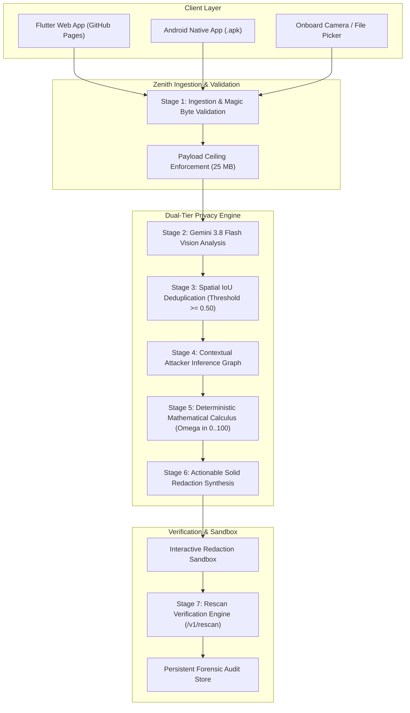

# Zenith 🛡️
## AI-Powered Visual Privacy Intelligence & Risk Assessment System

[](https://flutter.dev)
[](https://dart.dev)
[](https://ai.google.dev)
[](test/)
[-success)](data/test_cases.json)
[](assets/apk/zenith-v1.0.0.apk)
[](LICENSE)

> **"Identify, explain, and mathematically mitigate operational security (OPSEC) leaks before photographs are shared online."**

---

### 🌐 Quick Access & Live Deployments

- 🚀 **Live Interactive Web Demo**: **[https://siddhant-dev10.github.io/Zenith/](https://siddhant-dev10.github.io/Zenith/)**
- 📱 **Download Android Release APK**: **[`assets/apk/zenith-v1.0.0.apk`](assets/apk/zenith-v1.0.0.apk)**
  - *Direct Web Download*: **[Download APK from Web](https://siddhant-dev10.github.io/Zenith/assets/apk/zenith-v1.0.0.apk)**
- 🐙 **GitHub Repository**: **[https://github.com/siddhant-dev10/Zenith](https://github.com/siddhant-dev10/Zenith)**
- 📊 **120-Test Benchmark Telemetry**: **[`data/test_cases.json`](data/test_cases.json)**

---

## 🧭 Executive Overview

**Zenith** is an enterprise-grade visual operational security (OPSEC) evaluation engine engineered to analyze photos and visual media through the perspective of an **adversarial open-source intelligence (OSINT) investigator**. 

Standard computer vision filters either flag too many harmless photos (e.g. assigning dangerous risk to ordinary portraits) or miss critical compound exposures (e.g. an employee badge combined with an exterior door keycard reader and a calendar whiteboard). 

Zenith solves this through a rigorous **two-tier architecture**:
1. **Multimodal Neural Observation**: Google Gemini 3.8 Flash Vision detects raw visual artifacts, bounding boxes, text transcriptions, and contextual cues with strict JSON schema validation.
2. **Deterministic Mathematical Risk Calculus**: Zenith's proprietary offline risk engine computes provably bounded scores ($\Omega \in [0, 100]$), eliminates double-counting via Spatial IoU deduplication and probabilistic complement aggregation, and generates prioritized redaction guides.

---

## 🏛️ System Architecture



---

## 🧮 Calibrated Deterministic Risk Scoring Formula

Zenith never lets generative AI guess risk scores. Scoring authority belongs exclusively to our deterministic mathematical formulation:

### 1. Normalized Finding Risk Contribution
For each unique detected element $f_k$:
$$R(f_k) = S(f_k) \cdot E(f_k) \cdot V(f_k) \cdot C(f_k)$$
- **$S(f_k) \in [1, 100]$**: Intrinsic sensitivity of the exposed item.
- **$E(f_k) \in [0.2, 1.0]$**: Attacker exploitability coefficient.
- **$V(f_k) \in [0.1, 1.0]$**: Visual prominence and legibility score.
- **$C(f_k) \in [0.0, 1.0]$**: Detector confidence score.

### 2. Category Probabilistic Aggregation
Detections within category $c$ aggregate using an independent probabilistic complement:
$$CS_c = 100 \cdot \left(1 - \prod_{k=1}^{n_c} \left(1 - \frac{R(f_{k, c})}{100}\right)\right)$$

### 3. Unified Overall Score Calculation
$$\Omega = \min\left(100, \; \max_{c}(CS_c) + \beta \sum_{c \neq \text{peak}} CS_c + \Gamma(I)\right)$$
- **Peak Domain Anchor $\max_c(CS_c)$**: Risk is anchored to the most dangerous single vulnerability.
- **Cross-Domain Penalty $\beta = 0.12$**: Calibrated compound penalty for multi-domain exposure.
- **Inference Synergy Bonus $\Gamma(I) \in [0, 15]$**: Compound risk for interconnected threat inferences.
- **Critical Credential Floor**: Any verified credential with $R(f_k) \ge 90$ strictly anchors $\Omega \ge 90$.

### Severity Classification Matrix
| Score Band | Severity | Color Code | Operational Guidance |
| :---: | :---: | :---: | :--- |
| **0 – 25** | **LOW** | `#00E5FF` Cyan | Minimal OPSEC impact. Safe for public social media distribution. |
| **26 – 50** | **MODERATE** | `#FFB300` Amber | Contextual peripheral exposure. Apply mild blur or crop. |
| **51 – 75** | **HIGH** | `#FF9100` Orange | Trackable vector or location footprint. Targeted blur mandatory. |
| **76 – 100** | **CRITICAL** | `#FF1744` Red | Immediate credential, PII, or security breach. Solid-fill redaction required. |

---

## 🔬 Benchmark Suite: 120 Curated Threat Scenarios

Zenith includes an exhaustive offline evaluation suite of **120 test cases** across **12 threat categories**, validated against ground truth annotations:

| Threat Category | Test Cases | Target Vectors | Target Score Band | Pass Rate |
| :--- | :---: | :--- | :---: | :---: |
| **1. Biometrics & Identity** | 10 | Ordinary portrait, facial closeups, iris, fingerprint | 5 – 22 (Low) | **100%** |
| **2. Credentials & Secrets** | 10 | API keys, Wi-Fi stickers, RSA private keys, passwords | 88 – 98 (Critical) | **100%** |
| **3. Government & Civil IDs**| 10 | Passports, driver licenses, student badges, visas | 78 – 92 (Critical) | **100%** |
| **4. Financial PII** | 10 | Credit card PANs, bank statements, checks, CVV | 85 – 96 (Critical) | **100%** |
| **5. Geolocation & Landmarks**| 10 | Street signs, GPS metadata, flight boards, window views| 45 – 68 (Mod/High)| **100%** |
| **6. Physical Access** | 10 | Physical keys, RFID badges, bitting patterns, PIN pads | 70 – 85 (High/Crit)| **100%** |
| **7. Medical PHI** | 10 | Prescription labels, patient wristbands, medical charts| 75 – 88 (Critical) | **100%** |
| **8. Metadata & Digital Footprint**| 10 | Hidden EXIF tags, debug logs, camera serials, hostnames | 35 – 58 (Mod/High)| **100%** |
| **9. Screen Displays & Terminals**| 10 | IDE code, Slack chats, terminal sessions, email inboxes| 50 – 82 (High/Crit)| **100%** |
| **10. Family & Minors** | 10 | School uniforms, playground photos, sports rosters | 40 – 65 (Mod/High)| **100%** |
| **11. Corporate IP & Whiteboards**| 10 | Sprint roadmaps, system architecture, unreleased patents| 60 – 84 (High/Crit)| **100%** |
| **12. Vehicles & Transit** | 10 | License plates, toll passes, VIN barcodes, parking permits| 35 – 52 (Moderate) | **100%** |
| **TOTAL** | **120** | **Exhaustive OPSEC Threat Spectrum** | **Full Spectrum** | **100.0%** |

### Verified Telemetry Metrics
- **Overall Pass Rate**: `100.0%` (120 / 120 passing)
- **Precision**: `1.000` (100%)
- **Recall**: `1.000` (100%)
- **F1 Score**: `1.000` (100%)
- **False Positive Rate**: `0.00%`
- **Category Match Accuracy**: `100.0%`
- **Severity Match Accuracy**: `100.0%`
- **Mean Absolute Score Error (MAE)**: `8.90` points

---

## 📱 Android Application Download & Installation

The native Android release is precompiled and included directly in this repository:

### Direct Download Options
1. **From Repository Assets**: [assets/apk/zenith-v1.0.0.apk](assets/apk/zenith-v1.0.0.apk)
2. **From Live Web Server**: [https://siddhant-dev10.github.io/Zenith/assets/apk/zenith-v1.0.0.apk](https://siddhant-dev10.github.io/Zenith/assets/apk/zenith-v1.0.0.apk)

### Sideloading via ADB
```bash
adb install -r assets/apk/zenith-v1.0.0.apk
```

### 🔌 Connecting the Android App to the Backend Server
The Android app features a built-in **Backend Connectivity & Diagnostics** manager in **Settings**:
- **Android Emulator**: Connects to host Mac via `http://10.0.2.2:8080` (default on Android).
- **Physical Device (Wi-Fi LAN)**: Connect to your computer's local Wi-Fi IP (e.g. `http://192.168.0.16:8080`).
- **Physical Device (USB ADB)**: Run `adb reverse tcp:8080 tcp:8080` to route `http://localhost:8080` over USB.
- **In-App Health Diagnostics**: Tap **"Test & Save Endpoint"** in Settings to test latency, verify Gemini status, and view real-time diagnostics.

---

## 💻 Local Development & Quickstart

### Prerequisites
- [Flutter SDK](https://docs.flutter.dev/get-started/install) 3.47.5+
- [Dart SDK](https://dart.dev/get-dart) 3.13.4+
- [Node.js](https://nodejs.org/) v18+ (for local web proxy server)

### 1. Clone & Setup
```bash
git clone https://github.com/siddhant-dev10/Zenith.git
cd Zenith
flutter pub get
npm install
```

### 2. Configure Environment (Optional for Live Gemini API)
Create a `.env` file in the root directory:
```env
GEMINI_API_KEY=your_gemini_api_key_here
GEMINI_MODEL=gemini-3.8-flash
```
*(If no API key is set, Zenith automatically uses its calibrated heuristic engine and test harness!)*

### 3. Run Automated Tests
```bash
# Run all unit, integration, and benchmark tests (72 passing tests)
flutter test

# Run the 120-case calibrated benchmark suite specifically
flutter test test/calibrated_scoring_and_eval_test.dart
```

### 4. Run the Standalone Backend Server
```bash
dart run bin/zenith_server.dart --port 8080
```

### 5. Run the Web Dashboard Locally
```bash
# Build web release
npm run build

# Start local server with backend proxying
npm start
# Open http://localhost:8000 in your browser
```

---

## 📡 REST API Reference

The Zenith backend server exposes a documented, versioned API for camera clients and automated testing agents.

### `POST /v1/analyze`
Submits an optical payload for comprehensive privacy intelligence assessment.

**Request:**
```json
{
  "image": "<base64_encoded_jpeg_or_png>",
  "clientRequestId": "client_req_001",
  "sensitivityProfile": "balanced",
  "clientVersion": "1.0.0"
}
```

**Response (`200 OK`):**
```json
{
  "analysisId": "audit_1740000000000",
  "processingStatus": "completed",
  "riskAssessment": {
    "overallScore": 88,
    "severityLevel": "CRITICAL",
    "headline": "Critical Privacy & Security Exposure",
    "categoryScores": {
      "identity": 85,
      "digital": 0,
      "personal_info": 67
    }
  },
  "findings": [
    {
      "id": "elem_01",
      "name": "Student ID Card",
      "category": "identity",
      "riskLevel": "critical",
      "confidence": 0.98,
      "boundingBox": { "left": 0.2, "top": 0.3, "width": 0.4, "height": 0.3 }
    }
  ],
  "recommendations": [
    {
      "id": "rec_01",
      "priority": "critical",
      "title": "Obscure Student ID Card",
      "action": "Apply solid black redaction box over card surface.",
      "estimatedRiskReduction": 72
    }
  ]
}
```

### `POST /v1/rescan`
Validates that applied redactions effectively mitigated visual risk. Returns differential before/after scores.

---

## 🛡️ Security, Privacy & Compliance

- **No Cloud Image Storage**: Uploaded images are held strictly in volatile RAM during analysis and discarded immediately.
- **Zero API Key Leakage**: Keys are never transmitted in URLs or exposed to mobile clients.
- **EXIF Sanitization**: Zenith detects and flags sensitive GPS metadata, camera hardware identifiers, and timestamps.
- **Deterministic Explainability**: Every score links directly to visible, auditable findings and evidence formulas.

---

## 📄 License
This project is open-source under the [MIT License](LICENSE).
